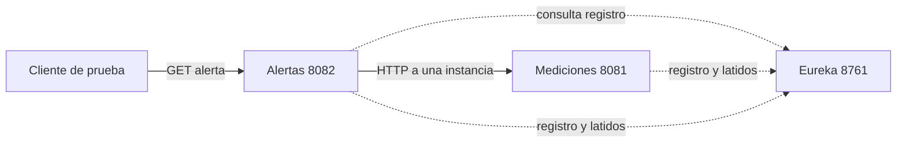

# Eureka y microservicios: empieza aquí

## Para leer en 2 minutos

**Microservicio:** un programa backend que resuelve una responsabilidad y expone una API HTTP. Por ejemplo, mediciones guarda lecturas y alertas decide si hay que revisar el riego.

**Eureka Server:** directorio de servicios. Guarda nombres de aplicaciones e instancias (host, puerto y estado). Ejemplo: `measurements-service` está en `localhost:8081`.

**Eureka Client:** biblioteca dentro de cada backend para registrarse, enviar latidos y consultar el directorio. Spring registra el servicio al agregar el starter y configurar su nombre.

**Spring Cloud LoadBalancer:** elige una instancia registrada cuando un cliente llama usando el nombre del servicio. En este ejemplo, alertas llama a `http://measurements-service/...` con un `RestTemplate` anotado `@LoadBalanced`.

**Firebase:** mantiene Authentication y Firestore del Lab6. Eureka no almacena sesiones, usuarios ni mediciones de negocio. El Android sigue funcionando igual en esta rama.

## Tu ejemplo en este repositorio

| Programa | Puerto | Función |
| --- | --- | --- |
| discovery-server | 8761 | Panel y registro Eureka |
| measurements-service | 8081 | POST de mediciones y GET de última lectura |
| alerts-service | 8082 | Consulta mediciones por nombre y evalúa umbrales |

La demo corre solo en tu PC (`127.0.0.1`), sin cuentas ni datos reales, con mediciones en memoria. Reiniciar mediciones borra sus datos. No incluye gateway ni conexión Firestore. Es una extensión educativa, no un requisito confirmado del enunciado original.

## Si el profesor pregunta

- **¿Qué hace Eureka?** Permite descubrir las direcciones de las instancias mediante nombres de servicio.
- **¿Qué es una instancia?** Una ejecución del servicio. Dos procesos del mismo servicio son dos instancias.
- **¿Eureka recibe todas las peticiones?** El cliente consulta/cacha el registro y llama directamente a una instancia. Eureka participa en el descubrimiento.
- **¿Qué significa UP?** La instancia figura disponible en el registro. Aun así una operación puede fallar o faltarle una dependencia.
- **¿Qué pasa si cae un servicio?** Una llamada puede fallar antes de que el registro/caché se actualice. Se necesitan timeouts y manejo de errores.
- **¿Android se registra en Eureka?** En esta arquitectura se registran los backends. Android llama a una URL de API/gateway.
- **¿Gateway y Eureka son iguales?** Gateway recibe y enruta peticiones; Eureka mantiene el directorio.
- **¿Necesito @EnableEurekaClient?** Para estos clientes basta el starter y la configuración. El servidor sí usa `@EnableEurekaServer`.

## Ejecutarlo en clase

Requisitos: JDK 17 o 21, Maven 3.9.x, Internet para descargar dependencias. IntelliJ puede usar su Maven integrado. Los proyectos Spring usan `microservices/pom.xml`; el `gradlew` de la raíz corresponde a Android.

Desde la raíz del repositorio:

```powershell
java -version
mvn -version
mvn -f microservices/pom.xml clean package
```

Abre tres terminales, todas en la raíz, y ejecuta en este orden:

```powershell
java -jar microservices/discovery-server/target/discovery-server-1.0.0.jar
```

```powershell
java -jar microservices/measurements-service/target/measurements-service-1.0.0.jar
```

```powershell
java -jar microservices/alerts-service/target/alerts-service-1.0.0.jar
```

Abre http://localhost:8761 y espera a que aparezcan `MEASUREMENTS-SERVICE` y `ALERTS-SERVICE`. La propagación puede tardar varios segundos. Si `mvn` no existe, importa `microservices/pom.xml` en IntelliJ y ejecuta **Lifecycle > package** desde su ventana Maven, o instala Maven desde https://maven.apache.org/download.cgi y agrega su carpeta `bin` a PATH.

### Registrar una lectura y obtener una alerta

En otra terminal PowerShell:

```powershell
$reading = @{ deviceId = 'sensor-01'; humidity = 20; temperature = 28 } | ConvertTo-Json
Invoke-RestMethod -Method Post -Uri 'http://localhost:8081/api/measurements' -ContentType 'application/json' -Body $reading
Invoke-RestMethod 'http://localhost:8081/api/measurements/latest?deviceId=sensor-01'
Invoke-RestMethod 'http://localhost:8082/api/alerts/sensor-01'
```

Esperado: `needsAttention: true` y mensaje de humedad baja. El umbral de 30 % es una regla inventada para la demo, no una recomendación agronómica. `measurementsInstance` muestra qué puerto respondió.

## Configuración que debes reconocer

Servidor, `microservices/discovery-server/src/main/resources/application.yml`:

```yaml
server:
  port: 8761
spring:
  application:
    name: discovery-server
eureka:
  client:
    register-with-eureka: false
    fetch-registry: false
```

Las dos opciones `false` corresponden al servidor independiente de la demo. Evitan que intente registrarse como cliente de otro servidor.

Cliente, dentro de cada servicio:

```yaml
spring:
  application:
    name: measurements-service
eureka:
  client:
    serviceUrl:
      defaultZone: http://localhost:8761/eureka/
```

`defaultZone` distingue mayúsculas: no cambiarlo por `default-zone`. `/eureka/` es la API del registro. La página del panel es `/`. `spring.application.name` es el nombre que usan los otros servicios para encontrarlo.

En `HttpConfig.java`, `@LoadBalanced` añade resolución de nombres al `RestTemplate`. La dependencia `spring-cloud-starter-loadbalancer` debe existir. Un navegador común no resuelve `http://measurements-service`: es un nombre lógico del backend.

## Recorrido de una petición

1. Eureka arranca en 8761.
2. Mediciones y alertas se registran con nombre, host y puerto.
3. Alertas obtiene y mantiene una copia del registro.
4. El usuario consulta `/api/alerts/sensor-01` en 8082.
5. El cliente de alertas busca `measurements-service` y el balanceador elige una instancia.
6. Mediciones responde con la última lectura del sensor.
7. Alertas evalúa los umbrales y devuelve JSON al usuario.



## Probar una segunda instancia

Mantén la primera y abre una cuarta terminal:

```powershell
java -jar microservices/measurements-service/target/measurements-service-1.0.0.jar --server.port=8083
```

Aparecerán dos instancias bajo `MEASUREMENTS-SERVICE`. **Cada una tiene su propia memoria**: registra la misma lectura en 8081 y 8083 antes de repetir las consultas de alertas:

```powershell
Invoke-RestMethod -Method Post -Uri 'http://localhost:8083/api/measurements' -ContentType 'application/json' -Body $reading
1..8 | ForEach-Object { Invoke-RestMethod 'http://localhost:8082/api/alerts/sensor-01' }
```

Observa `measurementsInstance`. El balanceador reparte entre las instancias disponibles; las cachés requieren tiempo para incorporar la nueva. En un sistema real ambas instancias del mismo servicio necesitan un almacenamiento persistente coherente. Distintos microservicios deben tener responsabilidades y propiedad de datos claras.

## Qué añadir a EcoHuerto

| Etapa | Cambio propuesto | Ejemplo de API | Estado aquí |
| --- | --- | --- | --- |
| 1 | Separar mediciones y alertas | APIs del ejemplo | Implementado en demo local |
| 2 | Catálogo de sensores y cultivos | GET /api/devices | Propuesta |
| 3 | Guardar historial persistente | POST /api/measurements con repositorio | Propuesta |
| 4 | Enviar alertas a Android | Notificaciones mediante FCM | Propuesta |
| 5 | Una entrada para Android | API Gateway | Propuesta |
| 6 | Proteger datos por usuario | Verificar Firebase ID Token en backend | Propuesta obligatoria antes de datos reales |

No ejecutar una bomba automáticamente con estos umbrales de ejemplo. Una automatización de riego real necesita controles, límites y validación del dispositivo.

## Adaptación al Lab6 de sesiones de estudio

El laboratorio corregido de esta rama trata sesiones de estudio. Para mantener ese dominio, reemplaza los ejemplos de sensores por:

- `sessions-service`: crear, listar, editar y eliminar sesiones del UID autenticado.
- `statistics-service`: consultar sesiones por servicio y sumar horas por mes/actividad/curso.
- Opcional `reminders-service`: avisos de metas de estudio.

Por ejemplo, `GET /api/statistics?course=IoT` consultaría `http://sessions-service/...` usando discovery y devolvería totales. Son propuestas de evolución, no endpoints ya implementados. La app Android actual sigue leyendo y escribiendo Firestore directamente. No dupliques escrituras en Firestore y una API sin definir cuál será la fuente de verdad.

## Android y Firebase en la arquitectura futura

1. Android inicia sesión con Firebase Authentication como ahora.
2. Android obtiene el **ID token** de Firebase con `getIdToken(false)`.
3. Envía `Authorization: Bearer <ID_TOKEN>` a una API HTTPS.
4. El backend valida el token con Firebase Admin SDK y obtiene el UID verificado.
5. La consulta a datos usa ese UID. Un `uid` enviado en el JSON no demuestra identidad.

Firestore Rules protegen peticiones del SDK cliente. Firebase Admin en servidor tiene privilegios y no depende de esas reglas: el backend debe aplicar autorización propia. Nunca pongas una cuenta de servicio Admin en Android o Git. Esta demo todavía no implementa ese flujo, por eso escucha solo en loopback y no recibe datos reales.

Conexiones locales: en el emulador Android, `10.0.2.2` apunta a la PC; en el celular físico se necesita una IP LAN alcanzable. Los servicios de esta demo escuchan solo en 127.0.0.1. Para acceso desde emulador/LAN hace falta configurar explícitamente la interfaz y limitar el acceso de red. Usar HTTP local requiere una excepción de tráfico claro solo en debug. Para despliegue usa HTTPS y autenticación.

## Errores frecuentes

| Error | Causa habitual | Solución |
| --- | --- | --- |
| Connection refused a 8761 | Eureka detenido | Arrancar discovery-server y revisar puerto |
| Servicio no aparece | Nombre/URL/puerto equivocado o registro pendiente | Revisar YAML y logs, esperar propagación |
| UnknownHostException measurements-service | Cliente HTTP sin discovery | Usar bean @LoadBalanced y starter loadbalancer |
| 503 al pedir alerta | No hay instancias o dependencia caída | Revisar panel y GET directo a 8081 |
| 404 de alerta para sensor | No se cargó lectura en la instancia elegida | Registrar lectura y revisar memoria por instancia |
| Port already in use | Otro proceso ocupa el puerto | Detenerlo o cambiar --server.port |
| Boot incompatible con Cloud | Mezcla de versiones | Respetar la matriz oficial y BOM |
| mvn no se reconoce | Maven fuera de PATH | Usar Maven integrado de IntelliJ o instalarlo |
| Unsupported class file | JDK incorrecto | Revisar java -version y JAVA_HOME |
| Sigue UP tras apagar | Heartbeats, caché y autopreservación | Esperar convergencia, revisar logs y probar la API |

No desactives el verificador de compatibilidad para ocultar una mezcla incorrecta de versiones. La demo fija Boot 3.5.8 con Cloud 2025.0.0 como combinación didáctica reproducible, no como la última versión para producción. Para un proyecto nuevo usa las versiones compatibles que indique el curso o Spring Initializr.

## Qué hace cada archivo

- `microservices/pom.xml`: padre Maven, módulos, versiones y BOM de Spring Cloud.
- `discovery-server/.../DiscoveryApplication.java`: servidor con `@EnableEurekaServer`.
- `measurements-service/.../MeasurementController.java`: valida y guarda lecturas en memoria.
- `alerts-service/.../HttpConfig.java`: cliente HTTP con balanceo y timeouts.
- `alerts-service/.../AlertController.java`: llama a mediciones por nombre y maneja fallos.
- `alerts-service/.../AlertPolicy.java`: umbrales educativos, independientes de HTTP.
- `src/test`: pruebas de endpoints y umbrales.

## Ejercicios para entenderlo

1. Cambia humidity de 20 a 60 y verifica que desaparezca la alerta de humedad baja.
2. Envía humidity=120: debe responder HTTP 400.
3. Pide un sensor inexistente: HTTP 404.
4. Detén mediciones y consulta alertas: después de los timeouts devuelve 503. Eureka puede conservar la instancia temporalmente.
5. Ejecuta dos instancias y observa el puerto que responde.
6. Explica por qué no conviene dividir cada clase Java en un microservicio: implica despliegues, red, fallos y consistencia adicionales.

## Fuentes oficiales

- Conceptos/configuración de Eureka, registro y latidos: https://docs.spring.io/spring-cloud-netflix/reference/4.3/spring-cloud-netflix.html
- Descubrimiento y clientes HTTP balanceados: https://docs.spring.io/spring-cloud-commons/reference/spring-cloud-commons/common-abstractions.html
- Matriz Boot/Cloud: https://github.com/spring-cloud/spring-cloud-release/wiki/Supported-Versions
- Requisitos de Boot 3.5: https://docs.spring.io/spring-boot/3.5/system-requirements.html
- Maven: https://maven.apache.org/install.html
- Verificación de ID tokens: https://firebase.google.com/docs/auth/admin/verify-id-tokens
